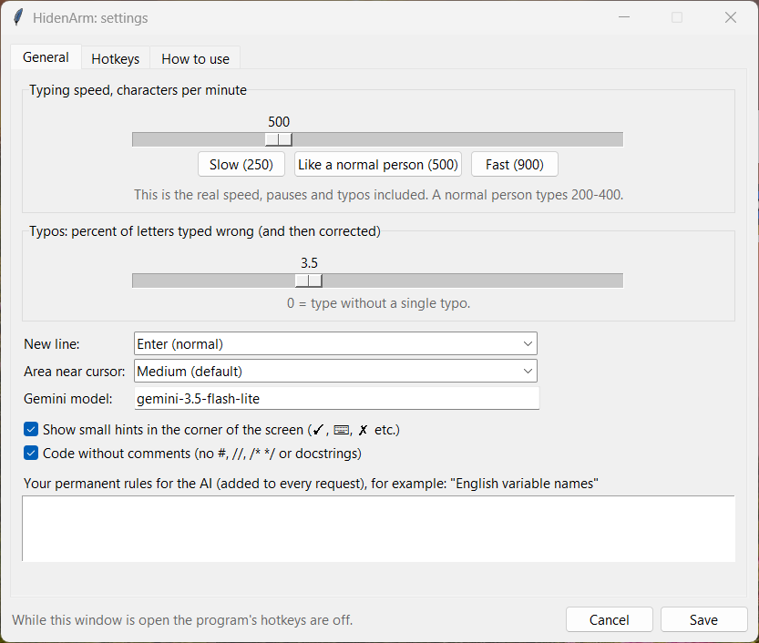
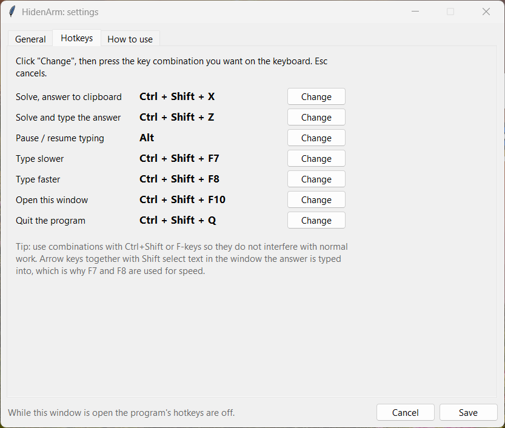

# HidenArm

**A hotkey assistant for Windows: point the mouse at a task or question, press one key combination, and the AI prepares the answer.**

HidenArm runs in the background with no window and no icon. It takes a screenshot, sends it to Google Gemini, finds the task or question next to the mouse cursor and delivers the answer: it puts it into the clipboard or types it into the field where your text cursor is.



## Features

- **One key combination.** Screenshot, solving and the answer without switching windows.
- **Knows what to solve.** Solves the task the mouse is pointing at and treats the rest of the screen as background.
- **Follows the conditions of the task.** Programming language, method, prohibitions (for example "no loops") and function names are taken from the text of the task.
- **Simple code.** Writes the simplest, most readable code, and optionally without comments.
- **Human-like typing.** The answer can be typed for you: steady pace, pauses, typos that get corrected. Pause and cancel are supported.
- **Speed in one keystroke.** Type faster or slower on the fly, in real characters per minute.
- **Settings window.** Speed, typos, hotkeys, your own rules for the AI and a built-in guide.
- **Reliable.** Retries on network errors and overload, can fall back to a backup model.
- **Key stays safe.** The API key lives in a Windows environment variable, not in the project files.

## Installation

1. Install Python 3.10+ from python.org (tick **Add python.exe to PATH**).
2. Get a free key at https://aistudio.google.com (**Get API key**).
3. Run `INSTALL.bat`. It installs the dependencies, saves the key in the `GEMINI_API_KEY` environment variable and starts the program.

The key is stored only in a Windows environment variable and is not in the repository. Do not paste the key into `config.json` and do not commit it.

Manual installation:

```powershell
pip install -r requirements.txt
setx GEMINI_API_KEY "YOUR_KEY"
```

Then sign out of Windows, sign in again and run `start.vbs`.

## How to use

1. Point the mouse at the task (no need to click).
2. Press **Ctrl+Shift+X**: the answer lands in the clipboard, paste it with Ctrl+V.
3. Or click into the answer field, move the mouse back to the task and press **Ctrl+Shift+Z**: the answer is typed for you.

## Hotkeys (defaults)

| Keys | Action |
|---|---|
| Ctrl+Shift+X | solve, answer to the clipboard |
| Ctrl+Shift+Z | solve and type the answer (press again to cancel typing) |
| Alt | pause / resume typing |
| Ctrl+Shift+F8 / F7 | type faster / slower |
| Ctrl+Shift+F10 | settings window and guide |
| Ctrl+Shift+F9 | reload `config.json` |
| Ctrl+Shift+Q | quit |

Every hotkey can be changed in the settings window. A detailed beginner guide is in [GUIDE.txt](GUIDE.txt).



## Project structure

- `solver.py`: the main program
- `humantype.py`: typing imitation
- `settings_ui.py`: settings window
- `config.json`: settings (leave the `api_key` field empty)
- `INSTALL.bat`, `start.vbs`: setup and launch

## Important

- Do not paste the API key into `config.json` and do not commit it to the repository. If a key is ever exposed, revoke it right away at aistudio.google.com.
- AI answers can be wrong, always check the result.
- Use the program only where it is allowed by the rules of the service, school, employer or exam.
